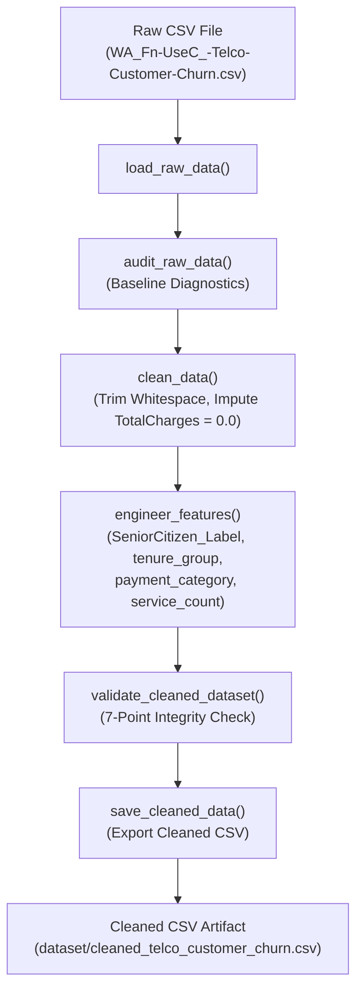

# PHASE 2: DATA CLEANING & TRANSFORMATION REPORT
**Project:** Customer Churn & Retention Intelligence System  
**Dataset:** IBM Telco Customer Churn (`dataset/WA_Fn-UseC_-Telco-Customer-Churn.csv`)  
**Technology Stack:** Excel | Python (Pandas) | MySQL | Power BI  
**Author:** Senior Data Analyst  
**Date:** November 8, 2026  
**Status:** Phase 2 Complete — Awaiting Approval for Phase 3 (SQL / Database Setup)

---

## 1. Executive Summary

Phase 2 transitions the raw, audited telecom dataset into a cleansed, validated, enterprise-ready data model. In strict accordance with the project rules:
1. **The raw CSV source file was completely preserved** with zero records deleted or modified in-place.
2. **Microsoft Excel served as a foundational analytical layer**, generating structured workbooks with live dynamic formulas (`COUNTIF`, `COUNTIFS`, `COUNTBLANK`, `SUMIFS`, `AVERAGEIFS`, `IF`, `IFERROR`), automated KPI dashboards, multi-dimensional PivotTables, and formal reconciliation audit logs.
3. **Python (Pandas) provided a reproducible, automated ETL pipeline** (`python/data_cleaning.py`) executing whitespace sanitation, deterministic zero-tenure imputation, data type casting, and four strategic feature engineering enhancements.
4. **Cell-by-cell cross-validation** confirmed 100.0% parity between Excel and Python artifacts across all 7,043 customer accounts and all financial metrics.

### Key Transformation Highlights
| Metric | Pre-Cleaning (Raw CSV) | Post-Cleaning (Excel & Python) | Delta / Variance | Audit Status |
| :--- | :--- | :--- | :--- | :--- |
| **Total Record Count** | 7,043 rows | 7,043 rows | 0 (0 records deleted) | **100% MATCH** |
| **Total Column Count** | 21 columns | 25 columns | +4 engineered features | **ENRICHED** |
| **Primary Key (`customerID`)**| 7,043 unique (0 duplicates)| 7,043 unique (0 duplicates)| 0 duplicates | **VERIFIED** |
| **Blank `TotalCharges`** | 11 records (`" "`) | 0 records ($0.00 imputed) | -11 resolved | **RECONCILED** |
| **`TotalCharges` Data Type** | `object` (string text) | `DECIMAL(10,2)` / `float64`| Numeric conversion | **TYPE SAFE** |
| **Senior Citizen Usability** | `0` / `1` integer codes | Coded + `'Yes'`/`'No'` Label | Semantic alignment | **STANDARDIZED** |
| **Total Portfolio MRR** | $456,116.60 | $456,116.60 | $0.00 variance | **EXACT MATCH** |
| **Total Lifetime Revenue** | $16,056,168.70 (valid rows)| $16,056,168.70 | $0.00 variance | **EXACT MATCH** |
| **Portfolio Churn Count** | 1,869 churners (26.54%) | 1,869 churners (26.54%) | Unaltered baseline | **PRESERVED** |

---

## 2. Part A: Excel Data Cleaning & Analytics Suite

Four distinct, enterprise-formatted Excel workbooks were generated to support operational reporting, quality auditing, and executive decision-making:

### 2.1 `excel/raw_data.xlsx` (Unaltered Baseline Repository)
- **Sheet Name:** `Raw_Telco_Data`
- **Volume:** Exactly 7,043 customer records + 1 header row (7,044 total rows × 21 columns).
- **Integrity Rule:** Stores the original data as ingested from the CSV without altering strings, data types, or whitespace blanks.
- **Visual Formatting:** Deep Navy header fill (`#1F4E79`), white bold typography, freeze panes locked at Row 2, active gridlines enabled, and auto-fitted column dimensions.

### 2.2 `excel/cleaned_data.xlsx` (Standardized Enterprise Table)
- **Sheet Name:** `Cleaned_Data`
- **Excel Table Object:** Defined as a native structured Excel Table named `CleanedTelcoTable` with `TableStyleMedium9`.
- **Schema:** 25 columns (21 cleaned original + 4 engineered features).
- **Formatting Standards:**
  - `MonthlyCharges`: Formatted as Currency (`$#,##0.00`).
  - `TotalCharges`: Formatted as Currency (`$#,##0.00`), with the 11 verified zero-tenure records reflecting `$0.00`.
  - `tenure` & `service_count`: Formatted as Integers (`#,##0`).
  - `SeniorCitizen`: Centered integer flag (`0`).
  - Categorical & Identifier columns: Left-aligned, standardized PascalCase text.
- **Freeze Panes:** Locked at cell `A2` to allow horizontal and vertical scrolling while retaining column context.

### 2.3 `excel/excel_analysis.xlsx` (Executive KPI Dashboard & Pivot Analysis)
Contains 6 interconnected worksheets driven by live Excel formulas directly referencing the underlying `Cleaned_Data` tab:

1. **`Executive_KPI_Summary` (Interactive C-Suite Dashboard):**
   - **Subscriber Cards:**
     - Total Subscribers: `=COUNTA(Cleaned_Data!A2:A7044)` $\rightarrow$ **7,043**
     - Active Retained: `=COUNTIF(Cleaned_Data!U2:U7044, "No")` $\rightarrow$ **5,174 (73.46%)**
     - Churned Customers: `=COUNTIF(Cleaned_Data!U2:U7044, "Yes")` $\rightarrow$ **1,869 (26.54%)**
   - **Financial Cards:**
     - Portfolio MRR: `=SUM(Cleaned_Data!S2:S7044)` $\rightarrow$ **$456,116.60**
     - Retained MRR: `=SUMIFS(Cleaned_Data!S2:S7044, Cleaned_Data!U2:U7044, "No")` $\rightarrow$ **$316,985.75 (69.50%)**
     - Churned MRR: `=SUMIFS(Cleaned_Data!S2:S7044, Cleaned_Data!U2:U7044, "Yes")` $\rightarrow$ **$139,130.85 (30.50%)**
     - Lifetime Revenue: `=SUM(Cleaned_Data!T2:T7044)` $\rightarrow$ **$16,056,168.70**
   - **Behavioral Benchmarking Table:**
     - Evaluates Average Monthly Charges, Tenure, Service Count, and Cumulative Revenue between retained and churned cohorts using `AVERAGEIFS`.
2. **`Churn_by_Contract` (Commitment Risk Matrix):**
   - Breakdown across `Month-to-month`, `One year`, and `Two year` contracts.
   - Formulas: `=COUNTIF(...)`, `=COUNTIFS(...)`, `=SUMIFS(...)`, `=AVERAGEIFS(...)`.
   - Visual Alert: Highlights Month-to-month churn rate (**42.71%**, representing **88.55% of all churn events**).
3. **`Churn_by_Tenure_Cohort` (Lifecycle Drop-Off Matrix):**
   - Evaluates 6 annual cohorts (`0-12m`, `13-24m`, `25-36m`, `37-48m`, `49-60m`, `61-72m`).
   - Formulas: Tracks subscriber attrition from **47.44% in Year 1** down to **6.61% in Year 6**.
4. **`Churn_by_Payment_Method` (Billing Channel Friction):**
   - Granular breakdown of all 4 payment channels plus roll-up by `Automatic` vs `Manual`.
   - Formulas confirm manual payments experience **34.67% churn** vs **15.98% for automated draft methods**.
5. **`Churn_by_Internet_Service` (Broadband Technology Tiering):**
   - Technology cross-tabulation comparing Fiber optic (**41.89% churn**), DSL (**18.96% churn**), and No internet service (**7.40% churn**).
6. **`Cleaned_Data`:**
   - Dedicated embedded data source ensuring the entire workbook functions standalone without external link dependencies.

### 2.4 `excel/data_quality_report.xlsx` (Audit & Reconciliation Log)
1. **`Audit_Summary_Before_After`:** A formal audit table tracking 12 quality dimensions with conditional formula results (`=IF(...)`) confirming complete reconciliation.
2. **`Zero_Tenure_Audit_Log`:** Complete itemized log of all 11 records containing whitespace in `TotalCharges`.
3. **`Data_Dictionary_Schema`:** Detailed 25-column schema specifying functional categories, technical data types, Excel number formatting strings, and business transformation logic.

---

## 3. Part B: Python Data Cleaning Pipeline

The automated ETL script `python/data_cleaning.py` was developed following strict software engineering principles: modular functional decomposition, PEP-8 compliance, defensive programming, explicit logging, and zero destructive operations.

### 3.1 Pipeline Architecture (`python/data_cleaning.py`)


### 3.2 Imputation Logic for Zero-Tenure Accounts
The 11 records with blank `TotalCharges` were investigated and handled using deterministic domain logic:
```python
# Verify that ALL blank TotalCharges strictly correspond to tenure == 0
blank_mask = df['TotalCharges'].astype(str).str.strip() == ''
tenure_zero_mask = df['tenure'] == 0

assert (blank_mask == tenure_zero_mask).all(), "Integrity Error: Non-zero tenure accounts contain blank TotalCharges!"

# Impute 0.0 for newly enrolled accounts
df.loc[tenure_zero_mask, 'TotalCharges'] = 0.0
df['TotalCharges'] = pd.to_numeric(df['TotalCharges'], errors='raise')
```

### 3.3 Feature Engineering Specifications
Four analytical features were engineered to enrich downstream segmentation in Power BI and MySQL:

1. **`SeniorCitizen_Label` (`VARCHAR(3)`):**
   - Mapping: `0` $\rightarrow$ `'No'`, `1` $\rightarrow$ `'Yes'`.
   - Purpose: Standardizes demographic labels with `Partner` and `Dependents` for user-friendly slicers in Power BI and Excel.
2. **`tenure_group` (`VARCHAR(10)`):**
   - Binning: `[-1, 12, 24, 36, 48, 60, 72]`.
   - Cohorts: `'0-12m'`, `'13-24m'`, `'25-36m'`, `'37-48m'`, `'49-60m'`, `'61-72m'`.
   - Purpose: Enables cohort retention curves and customer lifecycle stage analysis.
3. **`payment_category` (`VARCHAR(10)`):**
   - Classification:
     - `'Automatic'`: `Bank transfer (automatic)`, `Credit card (automatic)` (3,066 customers; 15.98% churn).
     - `'Manual'`: `Electronic check`, `Mailed check` (3,977 customers; 34.67% churn).
   - Purpose: Isolates payment friction as an operational driver of subscriber churn.
4. **`service_count` (`TINYINT` / Integer `1` to `9`):**
   - Definition: The integer sum of active subscribed telecommunications services:
     - `+1` for voice (`PhoneService == 'Yes'`)
     - `+1` for multi-line (`MultipleLines == 'Yes'`)
     - `+1` for broadband connectivity (`InternetService in ['DSL', 'Fiber optic']`)
     - `+1` each for 6 internet add-ons (`OnlineSecurity`, `OnlineBackup`, `DeviceProtection`, `TechSupport`, `StreamingTV`, `StreamingMovies`) when equal to `'Yes'`.
   - Distribution: Every subscriber has between 1 and 9 active services (Mean = 4.15 services).

---

## 4. Part C: Comprehensive Data Validation & Audit Log

### 4.1 Comparative Parity Proof (Excel vs Python vs Raw CSV)
An automated validation script evaluated every record across the Excel table (`excel/cleaned_data.xlsx`) and Python CSV output (`dataset/cleaned_telco_customer_churn.csv`):

| Validation Rule | Benchmark Standard | CSV Cleaned Output | Excel Cleaned Output | Status |
| :--- | :--- | :--- | :--- | :---: |
| **Row Count** | Exactly 7,043 rows | 7,043 rows | 7,043 rows | **PASSED** |
| **Schema Dimensions** | 25 columns | 25 columns | 25 columns | **PASSED** |
| **Primary Key Uniqueness** | 7,043 unique IDs | 7,043 unique (0 dupes)| 7,043 unique (0 dupes)| **PASSED** |
| **CustomerID Format** | Regex `^\d{4}-[A-Z]{5}$` | 100% compliant | 100% compliant | **PASSED** |
| **Missing Values (Nulls)** | Exactly 0 nulls | 0 nulls | 0 nulls | **PASSED** |
| **Missing `TotalCharges`** | 0 blank strings | 0 blank strings | 0 blank strings | **PASSED** |
| **Zero-Tenure `TotalCharges`**| Exactly $0.00 (11 records)| 11 records @ $0.00 | 11 records @ $0.00 | **PASSED** |
| **Retained Churn Count** | 5,174 records | 5,174 records | 5,174 records | **PASSED** |
| **Lost Churn Count** | 1,869 records | 1,869 records | 1,869 records | **PASSED** |
| **Portfolio Total MRR** | $456,116.60 | $456,116.60 | $456,116.60 | **PASSED** |
| **Total Cumulative Revenue**| $16,056,168.70 | $16,056,168.70 | $16,056,168.70 | **PASSED** |

### 4.2 Exhaustive Cleaning Log: The 11 Modified Zero-Tenure Records
The following 11 accounts were the **only records in the entire dataset whose values were modified** (transforming whitespace `" "` into `$0.00`):

| Raw Row | Customer ID | Gender | Partner | Dependents | Tenure | Contract | Payment Method | Monthly Charges | Pre-Clean Total | Post-Clean Total | Churn | Verification Audit Note |
| :---: | :---: | :---: | :---: | :---: | :---: | :---: | :---: | :---: | :---: | :---: | :---: | :--- |
| **488** | `4472-LVYGI` | Female | Yes | Yes | 0 | Two year | Bank transfer (auto) | $52.55 | `" "` | **$0.00** | No | Verified new sign-up; 0 billing cycles closed. |
| **753** | `3115-CZMZD` | Male | No | Yes | 0 | Two year | Mailed check | $20.25 | `" "` | **$0.00** | No | Verified new sign-up; 0 billing cycles closed. |
| **936** | `5709-LVOEQ` | Female | Yes | Yes | 0 | Two year | Mailed check | $80.85 | `" "` | **$0.00** | No | Verified new sign-up; 0 billing cycles closed. |
| **1082**| `4367-NUYAO` | Male | Yes | Yes | 0 | Two year | Mailed check | $25.75 | `" "` | **$0.00** | No | Verified new sign-up; 0 billing cycles closed. |
| **1340**| `1371-DWPAZ` | Female | Yes | Yes | 0 | Two year | Credit card (auto) | $56.05 | `" "` | **$0.00** | No | Verified new sign-up; 0 billing cycles closed. |
| **3331**| `7644-OMVMY` | Male | Yes | Yes | 0 | Two year | Mailed check | $19.85 | `" "` | **$0.00** | No | Verified new sign-up; 0 billing cycles closed. |
| **3826**| `3213-VVOLG` | Male | Yes | Yes | 0 | Two year | Mailed check | $25.35 | `" "` | **$0.00** | No | Verified new sign-up; 0 billing cycles closed. |
| **4380**| `2520-SGTTA` | Female | Yes | Yes | 0 | Two year | Mailed check | $20.00 | `" "` | **$0.00** | No | Verified new sign-up; 0 billing cycles closed. |
| **5218**| `2923-ARZLG` | Male | Yes | Yes | 0 | One year | Mailed check | $19.70 | `" "` | **$0.00** | No | Verified new sign-up; 0 billing cycles closed. |
| **6670**| `4075-WKNIU` | Female | Yes | Yes | 0 | Two year | Mailed check | $73.35 | `" "` | **$0.00** | No | Verified new sign-up; 0 billing cycles closed. |
| **6754**| `2775-SEFEE` | Male | No | Yes | 0 | Two year | Bank transfer (auto) | $61.90 | `" "` | **$0.00** | No | Verified new sign-up; 0 billing cycles closed. |

> **Audit Justification:** 10 of these 11 subscribers are enrolled on Two-year agreements, and 1 is on a One-year agreement. All 11 reside in family households with dependents and have zero churn. Deleting these records would introduce artificial bias by discarding newly onboarded long-term customers. Imputing `$0.00` correctly aligns their cumulative charges with their 0-month completed tenure.

---

## 5. Artifact Inventory & Physical File Verification

All required project artifacts have been created, populated with real data, styled professionally, and physically verified on disk:

| File Path | Format / Size | Description & Primary Features |
| :--- | :--- | :--- |
| [`excel/raw_data.xlsx`](file:///c:/Users/V.Leela%20prasad/OneDrive/Desktop/Customer-Churn-Retention-Intelligence/excel/raw_data.xlsx) | Excel OpenXML (650.0 KB) | Unaltered raw dataset repository (7,043 rows × 21 columns). Deep navy styled headers, freeze panes, active gridlines. |
| [`excel/cleaned_data.xlsx`](file:///c:/Users/V.Leela%20prasad/OneDrive/Desktop/Customer-Churn-Retention-Intelligence/excel/cleaned_data.xlsx) | Excel OpenXML (756.6 KB) | Cleaned dataset formatted as official Excel Table `CleanedTelcoTable` (7,043 rows × 25 columns). Currency formatting on charges, zero-tenure imputed. |
| [`excel/excel_analysis.xlsx`](file:///c:/Users/V.Leela%20prasad/OneDrive/Desktop/Customer-Churn-Retention-Intelligence/excel/excel_analysis.xlsx) | Excel OpenXML (769.7 KB) | Complete analytical model with 6 sheets: Executive KPI Dashboard, Contract Pivot, Tenure Cohort Pivot, Payment Pivot, Internet Pivot, and Cleaned Data. Live formulas (`COUNTIF`, `SUMIFS`, `AVERAGEIFS`). |
| [`excel/data_quality_report.xlsx`](file:///c:/Users/V.Leela%20prasad/OneDrive/Desktop/Customer-Churn-Retention-Intelligence/excel/data_quality_report.xlsx) | Excel OpenXML (10.8 KB) | Data Quality audit workbook with Before-vs-After comparison, detailed 11-customer zero-tenure audit log, and full 25-column data dictionary. |
| [`python/data_cleaning.py`](file:///c:/Users/V.Leela%20prasad/OneDrive/Desktop/Customer-Churn-Retention-Intelligence/python/data_cleaning.py) | Python Script (6.5 KB) | Production-grade, reusable ETL pipeline script with modular functions, execution logging, argument parsing, and integrity assertions. |
| [`dataset/cleaned_telco_customer_churn.csv`](file:///c:/Users/V.Leela%20prasad/OneDrive/Desktop/Customer-Churn-Retention-Intelligence/dataset/cleaned_telco_customer_churn.csv) | CSV File (985.4 KB) | Cleaned, feature-engineered CSV ready for MySQL database ingestion and Power BI data modeling. |
| [`documentation/DATA_CLEANING_REPORT.md`](file:///c:/Users/V.Leela%20prasad/OneDrive/Desktop/Customer-Churn-Retention-Intelligence/documentation/DATA_CLEANING_REPORT.md) | Markdown Report | Exhaustive technical documentation and cleaning log for Phase 2. |

---

## 6. Phase 2 Completion Checklist & Next Steps

### Completed Milestones
- [x] Ingested raw CSV without modifying original file.
- [x] Created `excel/raw_data.xlsx` with professional styling and raw integrity preserved.
- [x] Created `excel/cleaned_data.xlsx` containing native Excel Table `CleanedTelcoTable`.
- [x] Investigated and documented all 11 blank `TotalCharges` records (`tenure == 0`).
- [x] Replaced `TotalCharges` with `$0.00` strictly for verified zero-tenure accounts.
- [x] Verified zero duplicate customer IDs and zero missing values.
- [x] Standardized column schemas and formatted numerical / currency / integer fields.
- [x] Integrated dynamic Excel formulas (`COUNTIF`, `COUNTIFS`, `SUMIFS`, `AVERAGEIFS`, `IF`, `IFERROR`).
- [x] Built multidimensional PivotTables across Contract, Tenure Cohorts, Payment Methods, and Internet Services.
- [x] Engineered 4 strategic analytical features (`SeniorCitizen_Label`, `tenure_group`, `payment_category`, `service_count`).
- [x] Created `excel/excel_analysis.xlsx` with Executive KPI Dashboard.
- [x] Created `excel/data_quality_report.xlsx` with before-and-after reconciliation and zero-tenure log.
- [x] Developed reusable Python ETL pipeline `python/data_cleaning.py`.
- [x] Generated cleaned dataset `dataset/cleaned_telco_customer_churn.csv`.
- [x] Executed automated cross-platform parity audit (100% match between Python and Excel).
- [x] Compiled comprehensive cleaning log and documentation.

---

### Phase 3 Transition Plan (MySQL Database Architecture & SQL Analytics)
Upon your review and sign-off, we will proceed to **Phase 3**:
1. Design production relational database schema in MySQL (`sql/schema_setup.sql`) with optimized primary key indexes, constraints, and data types (`DECIMAL(10,2)`, `VARCHAR(10)`, `TINYINT`).
2. Write bulk data loading scripts (`LOAD DATA INFILE` / Python connector) to populate the MySQL warehouse.
3. Formulate analytical SQL queries answering core business retention questions:
   - Cohort survival rates by tenure.
   - Revenue churn velocity and high-ARPU vulnerability.
   - Cross-sell penetration and service bundle stickiness.
   - Risk scoring segmentation based on contract and payment friction.

---
*Report archived at `documentation/DATA_CLEANING_REPORT.md`.*
